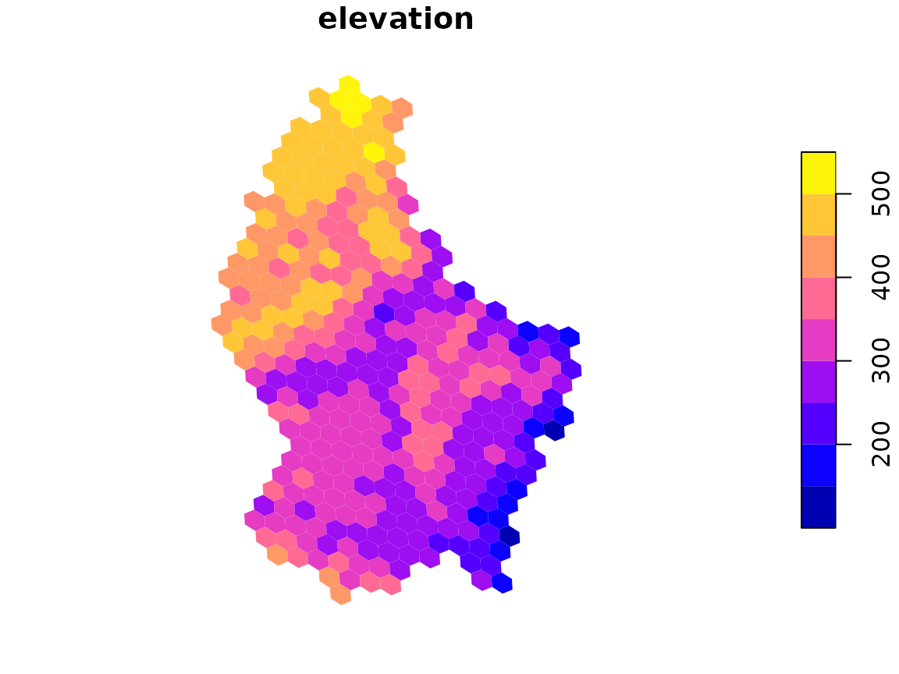
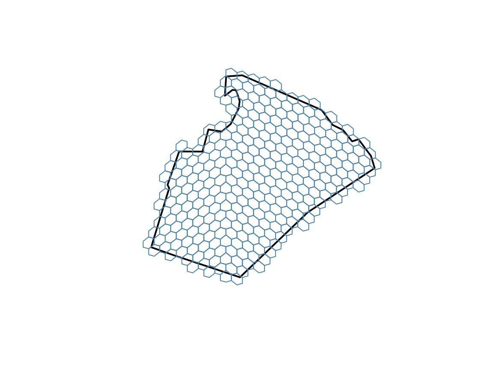

# Rasters and polygons

Much spatial data arrives as rasters (gridded images such as elevation
or climate) or as polygons (such as countries or study areas). This
vignette shows how to move both onto globalhex cells. It uses the
[terra](https://rspatial.github.io/terra/),
[exactextractr](https://isciences.gitlab.io/exactextractr/), and
[sf](https://r-spatial.github.io/sf/) packages.

``` r

library(globalhex)
library(terra)
```

## From raster to cells

terra includes a small elevation raster of Luxembourg:

``` r

elevation <- rast(system.file("ex/elev.tif", package = "terra"))
elevation
#> class       : SpatRaster
#> size        : 90, 95, 1  (nrow, ncol, nlyr)
#> resolution  : 0.008333333, 0.008333333  (x, y)
#> extent      : 5.741667, 6.533333, 49.44167, 50.19167  (xmin, xmax, ymin, ymax)
#> coord. ref. : lon/lat WGS 84 (EPSG:4326)
#> source      : elev.tif
#> name        : elevation
#> min value   :       141
#> max value   :       547
```

[`raster_to_cell()`](https://flmnh-ai.github.io/globalhex/reference/raster_to_cell.md)
finds every cell that overlaps the raster and summarizes the pixels
inside each one:

``` r

elevation_hex <- raster_to_cell(elevation, resolution = 8, progress = FALSE)
elevation_hex
#> # A tibble: 345 × 2
#>    cell       elevation
#>    <gh_cell>      <dbl>
#>  1 0006255506      439.
#>  2 0006255501      485.
#>  3 0006255512      481.
#>  4 0006255513      477.
#>  5 0006032664      493.
#>  6 0006032606      491.
#>  7 0006255434      445.
#>  8 0006255435      442.
#>  9 0006255566      476.
#> 10 0006255560      450.
#> # ℹ 335 more rows

plot(elevation_hex)
```



The result is a `hex_data` object, so everything in
[`vignette("plotting")`](https://flmnh-ai.github.io/globalhex/articles/plotting.md)
applies. Cells where the raster has no data are dropped; use
`drop_na = FALSE` to keep them.

### How pixels are summarized

By default, each cell gets the **area-weighted mean** of the pixels it
overlaps. A pixel that is only partly inside a cell counts only for the
part inside. Area weighting matters for longitude/latitude rasters,
whose pixels get smaller toward the poles. For categorical rasters, such
as land cover, the default is the most common class, weighted the same
way.

Choose other summaries with `fun`, using any [exactextractr
summary](https://isciences.gitlab.io/exactextractr/reference/exact_extract.html):

``` r

elevation_range <- raster_to_cell(
  elevation,
  resolution = 7,
  fun = c("min", "max"),
  progress = FALSE
)
elevation_range
#> # A tibble: 62 × 3
#>    cell      elevation_min elevation_max
#>    <gh_cell>         <dbl>         <dbl>
#>  1 000625551           461           493
#>  2 000625550           394           505
#>  3 000603260           469           547
#>  4 000625556           371           516
#>  5 000603266           424           517
#>  6 000625543           342           479
#>  7 000625553           371           515
#>  8 000603263           471           471
#>  9 000625542           374           507
#> 10 000625552           323           519
#> # ℹ 52 more rows
```

Set `weights = NULL` to weight pixels only by how much of each one falls
inside the cell, without accounting for pixel area.

## Into cells you already have

If you already have cells, perhaps from binning points, bring raster
values into them with one of two functions:

- [`cell_extract()`](https://flmnh-ai.github.io/globalhex/reference/cell_extract.md)
  uses the same exact, area-weighted summaries as
  [`raster_to_cell()`](https://flmnh-ai.github.io/globalhex/reference/raster_to_cell.md).
- [`cell_sample()`](https://flmnh-ai.github.io/globalhex/reference/cell_sample.md)
  reads the single pixel under each cell’s center. It is much faster but
  ignores the rest of the cell, so it suits rasters whose pixels are
  smaller than the cells.

``` r

sites <- point_to_cell(
  data.frame(lon = c(6.13, 5.97, 6.36), lat = c(49.61, 49.90, 49.75)),
  resolution = 7
)

cell_extract(sites, elevation)
#> # A tibble: 3 × 2
#>   cell      elevation
#>   <gh_cell>     <dbl>
#> 1 000625526      319.
#> 2 000625505      416.
#> 3 000625536      334.
cell_sample(sites, elevation)
#> # A tibble: 3 × 2
#>   cell      elevation
#>   <gh_cell>     <int>
#> 1 000625526       314
#> 2 000625505       370
#> 3 000625536       363
```

## Rasters that cover the globe

Global rasters work the same way. Rasters whose longitudes run from 0 to
360, or that use a projected coordinate system, are handled
automatically. A global grid has many cells at fine resolutions (see the
table in
[`vignette("globalhex")`](https://flmnh-ai.github.io/globalhex/articles/globalhex.md)),
so
[`raster_to_cell()`](https://flmnh-ai.github.io/globalhex/reference/raster_to_cell.md)
stops with an error if a result would exceed `max_cells`. Raise it
deliberately when you need more.

## From polygons to cells

[`cell_cover()`](https://flmnh-ai.github.io/globalhex/reference/cell_cover.md)
returns the cells whose **centers** fall inside a polygon:

``` r

counties <- sf::st_read(system.file("shape/nc.shp", package = "sf"), quiet = TRUE)
county <- counties[counties$NAME == "Wake", ]

wake_cells <- cell_cover(county, resolution = 8)
length(wake_cells)
#> [1] 292
```

``` r

plot(sf::st_geometry(county), border = "black", lwd = 2)
plot(sf::st_geometry(sf::st_as_sf(wake_cells)), add = TRUE, border = "steelblue")
```



Because selection is by cell center, cells along the edge may stick out
of the polygon or leave small gaps. Use a finer resolution to follow the
edge more closely.

Holes in polygons, such as a lake inside a park, are excluded by
default; set `include_holes = FALSE` to ignore them. Large polygons at
fine resolutions can produce a great many cells, so
[`cell_cover()`](https://flmnh-ai.github.io/globalhex/reference/cell_cover.md)
also has a `max_cells` limit.

## Back to sf

To combine cells with other vector data, convert them to sf polygons
with
[`sf::st_as_sf()`](https://r-spatial.github.io/sf/reference/st_as_sf.html).
Each row is one cell:

``` r

sf::st_as_sf(wake_cells[1:3])
#> Simple feature collection with 3 features and 1 field
#> Geometry type: POLYGON
#> Dimension:     XY
#> Bounding box:  xmin: -78.75 ymin: 36.03853 xmax: -78.63901 ymax: 36.08575
#> Geodetic CRS:  WGS 84
#> # A tibble: 3 × 2
#>   cell                                                                  geometry
#>   <gh_cell>                                                        <POLYGON [°]>
#> 1 0200314306 ((-78.713 36.05799, -78.713 36.07394, -78.73149 36.08575, -78.75 3…
#> 2 0200314361 ((-78.67602 36.05034, -78.676 36.06629, -78.69449 36.07809, -78.71…
#> 3 0200314363 ((-78.63904 36.04269, -78.63901 36.05864, -78.65749 36.07044, -78.…
```
